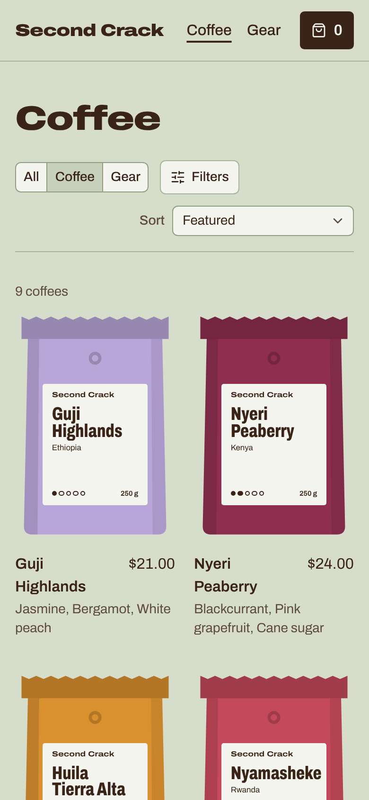

# Second Crack: a specialty coffee storefront

A demo ecommerce site for a small roastery, built with React 19, TypeScript, Vite, Tailwind CSS v4 and shadcn/ui.
No backend: products are in `src/data/products.ts`, and the cart and orders are saved in the browser's localStorage.


| Product page | Shop on mobile |
| --- | --- |
|  |  |

## Run it

```bash
pnpm install
pnpm dev        # http://localhost:5173
pnpm build      # type-check and production build
pnpm lint
```

## What's in it

| Route | Page |
| --- | --- |
| `/` | Home: next roast date, this week's coffees, how shipping works, gear |
| `/shop?type=coffee` | Catalog with roast, flavor and process filters plus sorting (all kept in the URL) |
| `/product/:slug` | Product page: size, grind, quantity, roast scale, origin details, related coffees |
| `/cart` | Full cart (a cart drawer also opens from the header) |
| `/checkout` | Contact, address and shipping form with validation; no payment is taken |
| `/order/:id` | Order confirmation |

```
src/
  data/products.ts        catalog (9 coffees, 4 pieces of gear)
  store/cart.tsx          cart context, persisted to localStorage
  lib/store.ts            prices, roast schedule, shipping rules
  lib/orders.ts           saving and reading demo orders
  components/ProductArt   SVG coffee bags and gear drawings (no image files)
  components/ui/          shadcn/ui components
  pages/                  one file per route
```

## Design

Built with Anthropic's `frontend-design` skill (in `.claude/skills/`). The palette comes from the coffee
supply chain: green-bean background `#d6ddcb`, parchment surfaces `#f3f5ee`, roast-brown ink `#3a2418` and
coffee-cherry actions `#b3202a`. One typeface, Archivo, uses its width axis: wide for headlines, condensed for bag labels.
Tokens are in `src/index.css`.

## Claude Code tooling

`.mcp.json` configures two MCP servers for Claude Code sessions in this folder:

- **shadcn**: browse and install real shadcn/ui components (`pnpm dlx shadcn@latest add <name>` also works).
- **playwright**: lets Claude open the site, take screenshots and read console errors.

## Next steps for a real store

- Swap localStorage orders for a backend, and add payments (for example Stripe Checkout).
- Load products from a CMS or a commerce API.
- Add tests (Playwright for the checkout flow, Vitest for cart logic).
