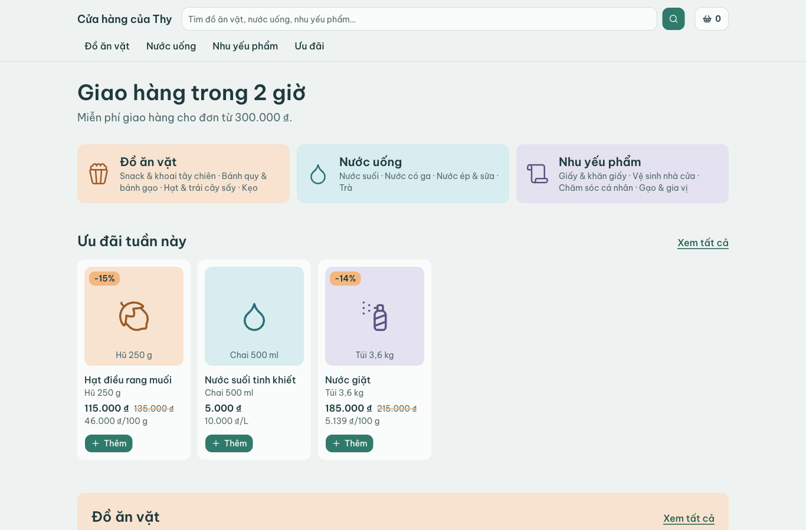
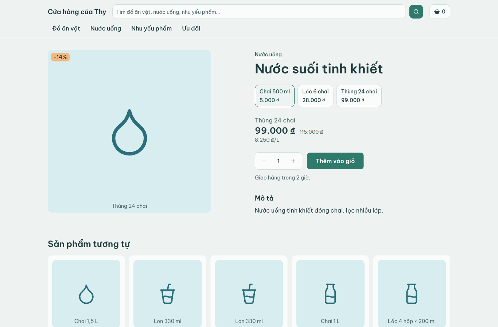
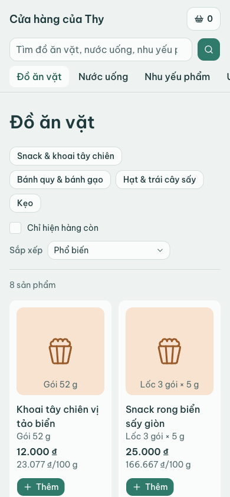

# Cửa hàng của Thy: a neighborhood grocery storefront

A demo ecommerce site for a small Vietnamese grocery that sells snacks, water and drinks, and everyday essentials,
built with React 19, TypeScript, Vite, Tailwind CSS v4 and shadcn/ui. The whole interface is in Vietnamese, prices are in đồng,
and orders are paid on delivery.
No backend: products are in `src/data/catalog.ts`, and the cart and orders are saved in the browser's localStorage.



| Product page | Category on mobile |
| --- | --- |
|  |  |

## Run it

```bash
pnpm install
pnpm dev        # http://localhost:5173
pnpm build      # type-check and production build
pnpm lint
pnpm test       # unit and component tests (Vitest)
pnpm exec playwright install chromium   # once, before the first browser test run
pnpm test:e2e   # browser tests (Playwright, starts the dev server itself)
pnpm check      # all of the above in one go
```

## What's in it

| Route | Page |
| --- | --- |
| `/` | Home: the 2-hour delivery promise and free-delivery rule, category tiles, this week's deals, a row per category |
| `/c/:slug` | Category (`do-an-vat`, `nuoc-uong`, `nhu-yeu-pham`): subcategory filter, sort, in-stock only, all kept in the URL |
| `/deals` | Every product with a pack on a deal |
| `/search?q=` | Search that ignores accents and case, name matches first |
| `/p/:slug` | Product page: pack choice, price and unit price, stock, quantity, similar products |
| `/cart` | Full cart with the free-delivery progress bar (a cart drawer also opens from the header) |
| `/checkout` | Name, phone, two-level Vietnamese address and an optional note; cash on delivery only |
| `/order/:id` | Order confirmation |

Product tiles add a product's first pack straight from the grid and turn into a quantity control.

```
src/
  data/catalog.ts         3 categories, 12 subcategories, 24 products with their packs and stock
  store/cart.tsx          cart context (product + pack per line, up to 99), persisted to localStorage
  lib/store.ts            price and unit-price formatting, discounts, delivery fee and promise
  lib/search.ts           accent- and case-insensitive product search
  lib/orders.ts           saving and reading demo orders
  components/ProductImage photo, or a placeholder in the category color with the subcategory icon
  components/ui/          shadcn/ui components
  pages/                  one file per route
```

## Design

Calm and quiet, like still water. A pale blue-green page `#EEF3F1` with near-white surfaces `#FAFCFB` and deep teal ink
`#1F3A3D`. One action color, sea green `#2F7A6B`, is used for buttons, links, focus and the free-delivery bar, and one warm
color, apricot `#F2B880`, marks deals and nothing else. Each category has its own soft tint for tiles and placeholders.
One typeface, Be Vietnam Pro, with full Vietnamese glyphs. No drop shadows and no load animations. Tokens are in `src/index.css`.

## Claude Code tooling

`.mcp.json` configures two MCP servers for Claude Code sessions in this folder:

- **shadcn**: browse and install real shadcn/ui components (`pnpm dlx shadcn@latest add <name>` also works).
- **playwright**: lets Claude open the site, take screenshots and read console errors.

## Next steps for a real store

- Swap localStorage orders for a backend, and keep stock levels there so they change as orders come in.
- Add product photos (set `image` on a product in `src/data/catalog.ts`; the placeholder steps aside on its own).
- Load products from a CMS or a commerce API.
